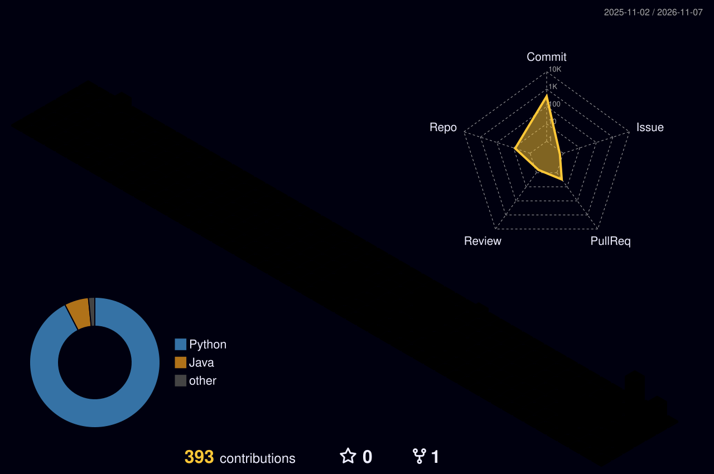

<div align="center">

  <!-- Header Banner -->
  

  <!-- Dynamic Terminal Typing Animation -->
  <a href="https://github.com/long0167472">
    
  </a>

  <br/>

  <!-- Status Badges & Live Profile Views Counter -->
  <a href="mailto:hoanglong7374@gmail.com">
    
  </a>
  <a href="https://github.com/long0167472">
    
  </a>
  

</div>

<br/>

<!-- Snake Game Animation eating contribution squares -->
<div align="center">
  <picture>
    <source media="(prefers-color-scheme: dark)" srcset="https://raw.githubusercontent.com/long0167472/long0167472/output/github-contribution-grid-snake-dark.svg">
    <source media="(prefers-color-scheme: light)" srcset="https://raw.githubusercontent.com/long0167472/long0167472/output/github-contribution-grid-snake.svg">
    
  </picture>
</div>

<br/>

<!-- 3D Isometric Contribution City skyline -->
<div align="center">
  
</div>

---

### 👨‍💻 About Me

- ☕ **Backend Software Engineer** specializing in **Java & the Spring Boot ecosystem**.
- 🛠️ Hands-on expertise architecting and maintaining **RESTful APIs, real-time WebSocket communication, and distributed data consistency**.
- 🛡️ **Engineering Philosophy:** System reliability and blast-radius minimization come first. I prioritize defensive exception handling, graceful degradation, and backward-compatible contract designs.
- 🚀 Passionate about **database query optimization, low-latency microservices, and workflow automation with Python**.

---

### 🛠️ Tech Stack & Ecosystem

<div align="center">
  <!-- Neon Dark Tech Icons -->
  
</div>

<br/>

| Category | Technologies & Production Tooling |
| :--- | :--- |
| **Languages & Core** | **Java (11 / 17 / 21)**, SQL, Python, JavaScript/TypeScript |
| **Frameworks & Libraries** | **Spring Boot**, Spring Cloud, Spring Data JPA / Hibernate, **WebSocket (STOMP / SockJS)** |
| **Databases & Caching** | **PostgreSQL**, Oracle Database, MySQL, **Redis Cache** |
| **Architecture & DevOps** | Microservices Architecture, RESTful API Standard, Docker, Linux, CI/CD, Git Flow |

---

### 🏛️ Core Engineering Blueprint

```
┌─────────────────────────────────┐   ┌─────────────────────────────────┐
│       System Reliability        │   │    Concurrency & Real-Time      │
│  • Blast-radius reduction       │   │  • WebSocket event routing      │
│  • Transactional integrity      │   │  • Non-blocking / async flows   │
│  • Defensive exception handling │   │  • Low-latency data pipelines   │
└─────────────────────────────────┘   └─────────────────────────────────┘
┌─────────────────────────────────┐   ┌─────────────────────────────────┐
│      Database Performance       │   │     Clean API & Contracts       │
│  • Index tuning & query plans   │   │  • Dynamic catalog validation   │
│  • Concurrency locks & isolations│  │  • Isolated error-routing envelope│
│  • Relational data consistency  │   │  • Decoupled & maintainable code│
└─────────────────────────────────┘   └─────────────────────────────────┘
```

---

### 📌 Featured Systems & Highlights

#### 🔹 [Enterprise Real-Time & Transactional Backend Service](https://github.com/long0167472)
* **Challenge:** Handling high-concurrency event publishing and transactional payload validation with zero data corruption.
* **Solution:**
  * Architected a modular Spring Boot service utilizing **WebSocket** communication and decoupled error-envelope routing.
  * Enforced strict real-time catalog validation directly backed by transactional database consistency.
  * Optimized indexing and query execution paths to prevent connection pool exhaustion during peak loads.
* **Tech Stack:** `Java 17` `Spring Boot` `WebSocket` `PostgreSQL` `Docker`

---

### 📊 GitHub Activity & Insights

<div align="center">
  <table border="0">
    <tr>
      <td align="center" width="50%">
        <!-- Dynamic Streak Stats -->
        
      </td>
      <td align="center" width="50%">
        <!-- Global Activity Stats -->
        
      </td>
    </tr>
  </table>
  
  <br/>
  
  <!-- Top Languages Distribution -->
  
</div>

---

### 📬 Connect With Me

<div align="center">

  [](mailto:hoanglong7374@gmail.com)
  [](https://github.com/long0167472)
  [](mailto:hoanglong7374@gmail.com)

</div>
